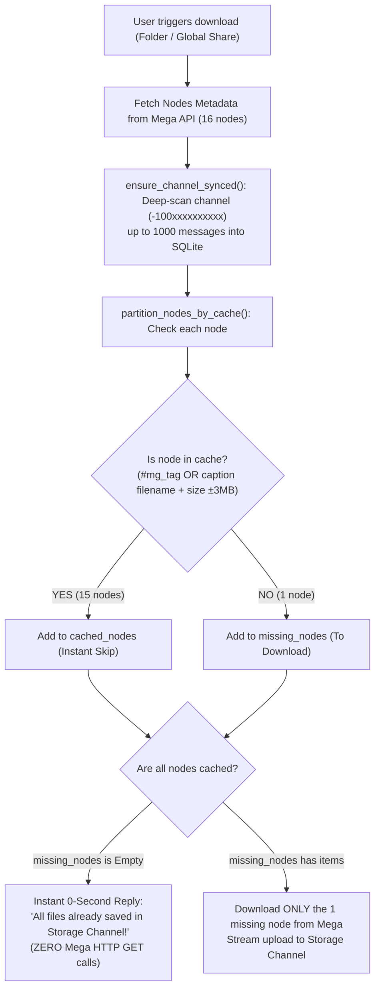

# 🧠 AGENT_MEMORY.md — Master Project Blueprint & Knowledge Base

> **NOTE FOR FUTURE AI AGENTS (Antigravity, Cursor, Claude, ChatGPT, etc.):**
> Read this entire document before touching or proposing any code in this repository.
> It contains the complete architectural decisions, user preferences, operational runbook, and exhaustive history of solved bugs for the **TeraBot (TeraBox & Mega Downloader)** project.

---

## 📌 1. Project Mission & Architecture Overview

**TeraBot** is an asynchronous Python Telegram bot that downloads files and folders from **Mega.nz** and **TeraBox**, processes them with zero-bandwidth deduplication and multi-threading, and uploads them to Telegram Storage Channels and users' chats up to Telegram's 2000 MB (2 GB) MTProto limit.

### 🛠️ Tech Stack & Key Modules:
- **Core Language**: Python 3.10+ (Asyncio-driven).
- **Telegram MTProto Client**: `Telethon` (custom session `terabot_session`, high-speed chunk streaming with multi-worker uploads).
- **Mega Engine**: Custom fast crypto engine using `cryptography` (OpenSSL AES-NI C bindings, ~1 GB/s) + fallback to PyCryptodome / pyaes, direct HTTPS chunk streaming via `aiohttp`. Optional CLI engines: `megatools`, `mega-cmd`.
- **TeraBox Engine**: Direct parallel chunk download via `aiohttp` streams (configurable 1–24 connections), custom resolver (`core/resolver.py`).
- **Database & Cache**: Dual-Engine Architecture:
  - **MongoDB Atlas (Primary Cloud Store)**: Shared persistence across Railway, Google Colab, and local workstation. Survives container rebuilds and notebook restarts.
  - **SQLite (Local Fallback)**: Embedded `aiosqlite` (`terabot.db`) fallback when `MONGO_URI` is not configured.
- **Media Processing**: `ffmpeg` for video duration extraction and automatic thumbnail generation.
- **Execution Environments**:
  - Primary: **Google Colab High-Speed Edition** (`terabot_v3_colab.ipynb` with 100+ GB disk, high RAM, and audio keep-alive) and **Railway Container Deployment**.
  - Secondary: Local Windows workstation (Python launcher `py`).

### 🗂️ Repository Directory Structure:
```text
terabot/
├── AGENT_MEMORY.md              # THIS FILE — Master Brain & Knowledge Base
├── bot.py                       # Main Telegram bot dispatcher, commands & event handlers
├── config.py                    # Environment configuration loader (.env)
├── requirements.txt             # Project dependencies (telethon, aiosqlite, motor, dnspython, etc.)
├── terabot_v3_colab.ipynb       # Production Google Colab notebook (pre-filled v3.0)
├── core/
│   ├── database.py              # Dual MongoDB Atlas + SQLite cache & deduplication engine
│   ├── mega_downloader.py       # Mega folder tree parser, Subfolder Explorer, streaming
│   ├── downloader.py            # TeraBox multi-stream downloader
│   ├── uploader.py              # Telethon high-speed album & standalone uploader
│   ├── resolver.py              # TeraBox link resolving & cookie management
│   └── queue_manager.py         # Concurrency slots & user rate-limiting
└── utils/
    ├── helpers.py               # Formatting (bytes, duration, filename sanitize)
    ├── logger.py                # Logging setup
    └── jokes.py                 # Fun waiting messages
```

### ⚙️ Environment Configuration (`.env` Schema):
```env
BOT_TOKEN=YOUR_BOT_TOKEN_HERE
API_ID=YOUR_API_ID_HERE
API_HASH=YOUR_API_HASH_HERE
ADMIN_IDS=YOUR_ADMIN_ID_HERE
ALLOWED_USERS=
PRIVATE_CHAT_ID=-100xxxxxxxxxx   # Storage Channel ID (Vault / Cache)
MONGO_URI=mongodb+srv://<username>:<password>@cluster0.xxxx.mongodb.net/?appName=Cluster0
MONGO_DB_NAME=terabot
TERABOX_COOKIE='ndus=YOUR_COOKIE_HERE;'
DOWNLOAD_STREAMS=12
MAX_FILE_SIZE_MB=2000
MAX_CONCURRENT_DOWNLOADS=2
USER_RATE_LIMIT_SECONDS=10
DOWNLOAD_DIR=downloads
```

---

## 👤 2. User Preferences & Critical Interaction Rules

1. **Language & Communication Style**:
   - The user communicates in **Hinglish / Hindi**. Responses should be concise, friendly, and structured in clean GitHub Markdown.
2. **"Code Mat Likho / Pehle Discuss Karo" Rule**:
   - When the user asks architectural questions or says "code mat likho", **DO NOT WRITE OR MODIFY CODE**. Present clear options, plans, or analysis first and wait for approval.
3. **Storage Channel First Philosophy**:
   - Channel ID: `-100xxxxxxxxxx` is the user's permanent **Storage Channel**.
   - All files must be archived to this channel.
4. **Zero-Bandwidth Deduplication Mandate**:
   - If a file is already in the storage channel, the bot must **NEVER download it from Mega or TeraBox servers**. It must be skipped upfront before stream connections are opened.
5. **Local Device Only for Prefilled Notebooks (STRICT GIT PRIVACY RULE)**:
   - When the user asks for prefilled Colab notebooks, **NEVER push real credentials to GitHub!**
   - The git-tracked notebook `terabot_v3_colab.ipynb` must ALWAYS have safe dummy placeholders (`YOUR_BOT_TOKEN_HERE`, etc.).
   - Prefilled notebooks must strictly stay on the local device as `*_prefilled.ipynb` (protected by `.gitignore`).

---

## 🚀 3. Core Business Logic & Algorithms

### 3.1. Zero-Bandwidth Upfront Batch Partitioning (`partition_nodes_by_cache`)
**Problem it solves**: Mega shares can contain tens or hundreds of videos. If 15 out of 16 videos are already uploaded to the user's storage channel, downloading all 16 wastes user time, server bandwidth, and triggers rate limits.

**Algorithm flow in `core/database.py` & `core/mega_downloader.py`**:


#### Multi-Layer Match Criteria:
1. **Server-Side Native Search & Hashtag Key**: Matches `#mg_<node_h>` or `#tb_<fs_id>` directly in the channel via Telegram's server search (no 100/1000 message scan limit, works across Colab restarts & Railway).
2. **Exact Byte Size Tag (`#sz_<bytes>`)**: Matches exact integer byte size in captions. Even if a file is renamed across folders, identical byte count triggers an instant skip!
3. **Caption Filename Extraction & Tolerance**: Telegram video documents often have `msg.file.name = None`. The engine parses captions with regex and matches size within ±3 MB tolerance. If names match but sizes are significantly different, the engine downloads the file (e.g. 720p vs 1080p).
4. **In-Folder Pre-De-duplication**: Identical files inside the same Mega share are de-duplicated upfront so only one copy is downloaded.

---

### 3.2. Mega Subfolder Explorer & Sequential Processing
1. **Interactive Navigation**:
   - When a Mega folder URL is sent, the bot decrypts the folder hierarchy and checks for top-level subfolders.
   - If subfolders exist, it presents the **Subfolder Explorer** (6 folders per page with pagination `⬅️ Previous` / `Next ➡️`, folder file counts, size summaries, search feature `🔍 Search Subfolder`).
2. **Folder-by-Folder Sequential Downloads**:
   - When a user downloads multiple folders (or Global Download), the bot processes them **strictly folder-by-folder**:
     - *Folder 1 downloads smallest-to-largest -> uploads to channel -> flushes albums -> sends report.*
     - *Only THEN does Folder 2 start.*
   - Cross-folder album mixing is strictly prevented by calling `await flush_album()` at the boundary of each folder.

---

### 3.3. Delivery Modes (`/delivery`)
User settings are stored in MongoDB Atlas `user_settings` collection (and SQLite fallback):
- **`channel` (Vault Mode / Zero Spam) [DEFAULT]**:
  - Files are saved directly to the Storage Channel (`-100xxxxxxxxxx`).
  - Zero media files are forwarded to the bot DM.
  - Bot DM receives only real-time progress cards and the final completion receipt with link to the channel.
- **`both` (Dual Mode / Optional)**:
  - Files are saved to the Storage Channel AND forwarded to the bot DM.
  - Already-cached files are silently skipped and NEVER forwarded as duplicate spam.

Users can toggle modes via `/delivery channel`, `/delivery both`, or interactive inline buttons:
`[ 🛡️ Channel Only (Vault) ]` | `[ 📬 Channel + Bot DM ]`
And directly inside the **Mega Subfolder Explorer & Global Hub** via a 1-tap quick toggle:
`[ 🛡️ Mode: Channel Only (Vault) 🔄 ]` / `[ 📬 Mode: Channel + Bot DM 🔄 ]`

---

### 3.4. Album Batching & Standalone Uploads
To prevent spamming 100 individual messages:
- **Album Eligibility**:
  - Photos: `<= 100 MB`
  - Videos: `<= 20 MB`
- **Batching Thresholds**:
  - Max 10 items per Telegram album.
  - Max 200 MB combined batch size.
- **Standalone Uploads**:
  - Videos `> 20 MB` or files not eligible for albums are uploaded individually with auto-generated video thumbnails.

---

### 3.5. Real-Time Visual Progress & Completion Receipts
**In-Flight Progress Card Layout**:
```text
[▰▰▰▰▰▰▰▰▱▱▱▱] 65.4% (42.1 MB / 64.3 MB) • 12.4 MB/s

📁 Folder [1/1]: Lillian Besas
----------------------------------------------
⚡ Status: Downloading from Mega: video16.mp4
⏩ Skipped: 15 file(s) (already saved)
⏱ ETA: 00:04

[🛑 Abort Task]
```

**Final Completion Receipt**:
```text
🎉 Mega Transfer Complete!

📂 Folder: Lillian Besas
🎯 Filter: VIDEO ONLY
📤 Newly Uploaded: 1 file(s) (64.3 MB)
⏩ Skipped (Already in Storage): 15 file(s) (1.15 GB)
📊 Total Handled: 16 file(s) (1.21 GB)
⚙️ Delivery Mode: 🛡️ Storage Channel Only (Vault Mode)

👇 Click below to view all files:
[ 🎬 Open Your Storage Channel ]   [ 🔄 Download Another Folder ]
```
- Direct channel button URL format: `https://t.me/c/<channel_id_without_100>/1`. (e.g. for `-1001234567890` -> `https://t.me/c/1234567890/1`).

---

## 🛠️ 4. Solved Bugs & Post-Mortem Knowledge Base

| Bug / Incident | Root Cause | Permanent Resolution |
| :--- | :--- | :--- |
| **1. Mega Existing Files Re-downloaded (Deduplication Fail)** | Telethon video uploads leave `msg.file.name` as `None`. Code was checking `file.name` instead of captions. Also checks were executed inside download loop instead of upfront. | Created `partition_nodes_by_cache()`. Upgraded `sync_channel_cache` to extract filenames from message captions via regex. Channel is indexed upfront up to 1000 messages. |
| **2. Ephemeral Colab VM Memory Loss** | Colab VMs recreate fresh `/content/terabot/terabot.db` on restart, wiping local file hashes. | Implemented `ensure_channel_synced()` before file checks so the fresh VM immediately crawls the storage channel into SQLite in 1–2 seconds. |
| **3. Global Download Callback Timeout** | Decrypting Mega API directory trees on large shares took > 10s. Telegram timed out the callback query. | Added instant `await event.answer()` on callback trigger; deferred heavy work to async task and edited status message. |
| **4. Telegram Markdown Parser Bold Crashes** | When folder names had special characters or when bold tags (`**action**`) collided with headers, Telethon's markdown parser threw entity offset errors. | Decoupled `folder_header` from the action block and sanitized string formatting in `render_mega_progress`. |
| **5. Forward Messages Crash on Channel Restrictions** | If the target user had strict forward privacy settings or Telegram channel had restriction flags, `forward_messages` raised an uncaught exception. | Wrapped all `client.forward_messages` calls in `try...except Exception as fwd_err` with fallback to individual upload. |
| **6. Telegram 2000 MB Upload Limit Rejection** | Telegram MTProto rejects files > 2000 MB for standard bot tokens, crashing upload streams. | Added upfront check against `config.MAX_FILE_SIZE_MB * 1024 * 1024` with user notification and skip logic. |
| **7. Cross-Folder Media Mixing in Albums** | When downloading multiple folders sequentially, leftover album items from Folder 1 were merged with Folder 2. | Added mandatory `await flush_album()` at the end of every folder iteration. |

---

## 📖 5. Commands Reference & Runbook

### 🤖 Telegram Bot Commands:
- `/start` — Welcome message, active delivery mode, active filter badge, and quick instructions.
- `/delivery` — View current delivery mode and toggle via inline buttons:
  - `[ 🛡️ Channel Only (Vault) ]` or `/delivery channel`
  - `[ 📬 Channel + Bot DM ]` or `/delivery both`
- `/filter <mode>` — Change file download filter:
  - `/filter video` — Download videos only (.mp4, .mkv, etc.).
  - `/filter photo` — Download images only (.jpg, .png, etc.).
  - `/filter other` — Download docs/archives only (.zip, .pdf, etc.).
  - `/filter all` — Download all files (filter off).
- `/stop` — Abort current active download/upload task for the user.
- `/broadcast <msg>` — (Admin only) Broadcast message to all bot users.

### 💻 Developer CLI Commands (Windows):
- Check compilation integrity:
  ```powershell
  py -m py_compile bot.py config.py core/database.py core/mega_downloader.py core/downloader.py core/uploader.py
  ```
- Run bot locally:
  ```powershell
  py bot.py
  ```
- Git update & push workflow:
  ```powershell
  git add bot.py core/database.py core/mega_downloader.py terabot_v3_colab.ipynb AGENT_MEMORY.md
  git commit -m "Description of changes"
  git push origin main
  ```

### ☁️ Google Colab Execution Workflow:
Open `terabot_v3_colab.ipynb` on Google Colab:
1. **Step 1 (System packages & clone)**: Runs `apt-get install megatools ffmpeg`, clones latest GitHub repo, installs `requirements.txt`.
2. **Step 2 (Credentials)**: Saves `.env` (pre-filled with bot token, API hash, channel ID `-100xxxxxxxxxx`).
3. **Step 3 (Anti-Disconnect Keep Alive)**: Starts silent audio loop to prevent Colab from sleeping.
4. **Step 4 (Start Bot)**: Runs `git pull && python bot.py`.

---

## 📈 6. Project Version History
- **v1.0**: Single TeraBox link downloader with Telethon upload.
- **v2.0**: Mega.nz direct AES-CTR streaming integration, Subfolder Explorer with pagination and search.
- **v3.0 (Current)**:
  - Sequential Folder-by-Folder downloader.
  - Zero-Bandwidth Upfront Storage Deduplication with channel caption inspection.
  - Dual Delivery Modes (`/delivery channel` Vault vs `/delivery both`).
  - 10-Item Telegram Album Batching.
  - Direct Storage Channel button receipt (`https://t.me/c/3798456772/1`).
  - Google Colab High-Speed Edition notebook.
